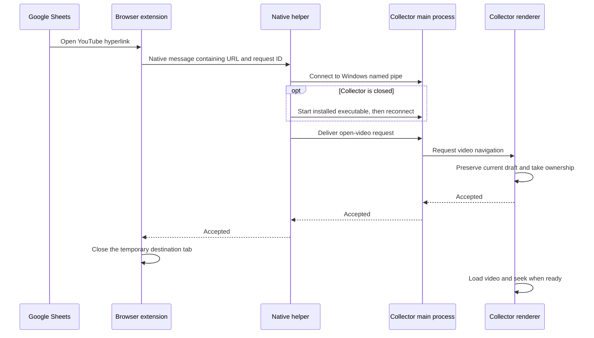

# Google Sheets to YouTube Collector Implementation Plan

## Intended Behavior

A client activates an existing YouTube hyperlink in Google Sheets. The browser
extension sends that link to the installed collector, which opens or restores its
window, selects the YouTube Collector tab, and seeks to the timestamp in the URL.

Use whole seconds. For example, `watch?v=6IHKf0lk0Yc&t=118s` opens at 1:58.
The initial release targets Windows and Google Chrome. The design can be adapted
to Microsoft Edge after its browser registration and navigation behavior are tested.

The client installs the updated collector and extension once. Normal use requires
no copying of video titles or URLs. Sheets retains its usual hyperlink interaction;
a temporary destination tab may appear during delivery.

## Architecture



Use Chrome native messaging between the extension and a small Python executable.
Use a Windows named pipe between that helper and Electron so the helper can receive
an actual delivery acknowledgement. This pipe is local to the Windows machine,
restricted to the current user, and needs no HTTP port or hosted service.

`accepted` means the renderer has preserved its outgoing state and taken ownership
of the request. It does not mean YouTube playback has succeeded. Delivery failures
leave the browser destination available; playback failures after acceptance appear
in the collector.

The helper attempts to connect to the running app first. If the app is absent, it
starts the configured collector executable, waits for the pipe, and delivers the
same request. Electron's single-instance lock prevents concurrent helpers from
opening duplicate collector windows. Requests received during startup wait for the
renderer readiness handshake.

## Phase 1: Validate the Real Sheets Navigation

Build a minimal unpacked Manifest V3 extension that records navigation metadata
for a test Google Sheet using representative URLs from `E:\Downloads\URL.xlsx`.

Verify direct `youtube.com/watch` links, `youtu.be` links, Google redirect wrappers,
and Sheets' hyperlink popup. Identify the source Sheets tab and destination tab.
Handle destination redirects and any observed navigation within the current tab.
Do not depend on reading spreadsheet cells from the page DOM.

Completion gate: one hyperlink activation produces one identifiable request with
the correct video ID and timestamp. This gate settles the navigation behavior
before building automatic tab closing.

## Phase 2: Add the Collector Receiver

Add `src/collector-link.js` for URL parsing and validation, and
`src/collector-bridge.js` for named-pipe delivery, startup queueing, request tracking,
and bounded timeouts. Keep `src/index.js` responsible for app lifecycle integration.

Support HTTPS watch URLs on explicitly allowed YouTube hosts and `youtu.be` share
URLs. Validate the complete hostname and the 11-character video ID. Read `t`,
`start`, and supported timestamp fragments; handle seconds and values such as
`1m58s`. Missing time means zero. Normalize accepted fractional times down to whole
seconds; reject invalid or negative times. Use the same URL fixtures for JavaScript
and Python validation. Normalize to an HTTPS watch URL.

Define a versioned request:

```json
{
  "version": 1,
  "type": "open-video",
  "requestId": "generated-uuid",
  "url": "https://www.youtube.com/watch?v=6IHKf0lk0Yc&t=118s"
}
```

Define matching responses with `version`, `requestId`, and `status`. An accepted
response uses `status: "accepted"`; an error includes a stable code and a short
message. Include errors for invalid URL, missing app, startup timeout, and failed
delivery. Add a lightweight connection-status request for the extension popup.

Use bounded, length-prefixed JSON on the pipe and handle partial reads. Derive a
stable pipe name per Windows user and app installation. Authenticate helper
connections with an installation token stored in user-only bridge configuration,
apply appropriate pipe access controls, and validate requests independently in
Electron. Deduplicate by request ID
with a bounded cache. The renderer applies the newest requested destination and
cancels outdated seek work when another request arrives.

Expose narrow preload methods for receiving navigation requests, announcing
renderer readiness, and returning acceptance or failure. Restore a minimized app
and bring it forward for a valid request. Bound startup waits, including when
existing adblocker initialization is slow or offline.

Completion gate: a local test client can request a video when the collector is
open, minimized, or closed, with one collector window and a matching response.

## Phase 3: Navigate and Preserve Collection Work

Add an external-video navigation entry point in `src/renderer.js` and use the
existing tab selection behavior from `src/tools-handler.js`.

Before switching to another video, snapshot pending markers and their editing
context as a draft associated with the outgoing video. Reset active editing state
for the new destination so markers cannot be saved against the wrong URL or row.
Restore the draft when revisiting that video. Include recoverable drafts in the
existing autosave data using optional fields, with readers that accept older
`.rhymx` files. Remove or update snapshots when users save or discard those markers.

When the requested video is already open, seek directly. Otherwise navigate the
existing YouTube webview, wait for the correct video and playable metadata, then
seek. DOM readiness alone is insufficient. Guard against stale requests, adverts,
and navigation to a different video. Reset marker polling state when the active
video changes so old capture events do not become new markers.

Opening a link previews the video; the user's existing marker controls determine
what is collected. Autoplay is best effort and must not determine whether seeking
or delivery is considered successful. Show unavailable-video or seek failures in
the collector without discarding drafts.

Completion gate: repeated timestamps in one video seek correctly, different videos
open correctly, and pending markers and row edits survive external navigation.

## Phase 4: Build the Native Helper

Add `tools/collector_native_host.py` and compile it with the existing PyInstaller
build workflow. Clients do not need Python installed.

Read and write Chrome's native messaging framing: a 32-bit native-endian byte
length followed by UTF-8 JSON. Use binary standard streams on Windows. Reserve
stdout for protocol messages and send diagnostics to stderr. Build and verify a
configuration that preserves those streams while producing no visible helper
console during a browser launch.

Read the collector executable path and pipe configuration from installer-managed
configuration. Validate the caller's extension origin and request contents. Connect
to the app, start it if needed using an argument list without a shell, and return
its acknowledgement. Detach the collector's standard streams so Electron logging
cannot corrupt the helper's native messages. Use bounded retries and an overall
startup timeout. Keep the
helper alive for the request and exit after returning the result.

Completion gate: the compiled helper works through Chrome native messaging,
including fragmented input, malformed requests, missing app, and app startup.

## Phase 5: Complete the Browser Extension

Add an `extension/` directory containing `manifest.json`, the service worker,
popup files, icons, and installation instructions. Use the verified navigation
behavior from Phase 1.

Request `nativeMessaging`, `webNavigation`, and `storage`, plus narrowly scoped
host access for Sheets, supported YouTube destinations, and necessary Google
redirect origins. Add further permissions only if the implemented API calls need
them. Check that the source URL is an actual Google Sheets spreadsheet.

Track destination tabs across redirects and service-worker restarts. Allocate one
request ID per link activation and prevent duplicate forwarding from overlapping
navigation events. Unwrap only supported Google redirect formats, then validate
the final YouTube URL. Retain pending tab ownership in session storage.

Call `runtime.sendNativeMessage` with the validated request. Close only the newly
created destination tab belonging to that request, after an accepted response and
a final check that the user has not navigated it elsewhere. Never close the source
Sheets tab or an existing browser tab. Restore Sheets after success where needed;
on failed delivery leave the destination available and show an extension error.
For navigation within the existing tab, keep that tab and restore its prior Sheets
location only after acceptance, if doing so preserves the user's navigation.

Provide an enable toggle, connection check, and last delivery status in the popup.
Persist the toggle across browser restarts. Do not forward ordinary YouTube browsing
that has no tracked Sheets source.

Completion gate: activating existing links in Sheets delivers exactly one request,
successful delivery cleans up only the correct temporary tab, and failures retain
a usable browser destination.

## Phase 6: Install, Update, and Distribute

Add `src/native-host-registration.js`. Generate the native host manifest and helper
configuration in a stable per-user directory, with absolute paths to the currently
installed helper and collector executable. Register `com.rhymx.collector` under
`HKCU\Software\Google\Chrome\NativeMessagingHosts`.

Use exact extension IDs in the host manifest's `allowed_origins`. Establish a stable
development extension ID and explicitly configure the production store ID.
Development registration must point to the development Electron executable and
entry path; production registration must point to the installed app.

Integrate registration with Squirrel installation and update events before the
existing `electron-squirrel-startup` handling exits. Refresh paths on normal startup
to repair stale registration. Uninstall removes this app's registration and bridge
configuration. Repeated registration must be harmless, and upgrades must continue
to work after versioned application directories change.

Add the helper to `build-executables.js`; verify that the existing Forge
`extraResource` configuration includes it. Ship an unpacked extension for the pilot,
then prepare a Chrome Web Store package for client installation. Store submission
and publication are separate release actions after the build passes acceptance.

Completion gate: a clean Windows user can install both components and open a Sheets
link, then update and uninstall without stale native host registration.

## Verification and Release Gates

Automated checks cover URL and timestamp parsing, native-message framing, pipe
timeouts and acknowledgements, duplicate delivery, navigation ownership across
redirects, stale seek cancellation, and marker draft preservation.

Manually verify the full flow in real Google Sheets with the packaged app. Include
app open/closed/minimized, another collector tab active, repeated timestamps,
different videos, rapid link activations, unsaved markers, and editing a saved row.
Also cover unavailable videos, missing helper, disabled extension, browser restart,
installer upgrade, and a clean install without Node.js or Python.

Pilot with a small client group and record real startup and delivery timing before
the wider release. Extend to Edge only after its native host registration, extension
ID, and navigation tests pass.

## Main Files

| File | Work |
| --- | --- |
| `src/index.js` | Single-instance lifecycle, bridge setup, install events, autosave additions |
| `src/preload.js` | Narrow navigation and acknowledgement APIs |
| `src/renderer.js` | External navigation, seeking, draft preservation |
| `src/tools-handler.js` | Reuse collector tab selection |
| `src/collector-link.js` | New URL and timestamp parser |
| `src/collector-bridge.js` | New named-pipe receiver and request lifecycle |
| `src/native-host-registration.js` | New native host registration and configuration |
| `tools/collector_native_host.py` | New native messaging executable |
| `build-executables.js` | Compile and bundle the helper |
| `forge.config.js` | Verify packaging resources and installer integration |
| `extension/` | Browser extension, popup, icons, development instructions |
| `tests/` | Focused parser, framing, delivery, and state regression coverage |

## Reference Documentation

- [Chrome native messaging](https://developer.chrome.com/docs/extensions/develop/concepts/native-messaging)
- [Chrome navigation API](https://developer.chrome.com/docs/extensions/reference/api/webNavigation)
- [Electron single-instance and startup handling](https://www.electronjs.org/docs/latest/tutorial/launch-app-from-url-in-another-app)
- [Electron Forge Squirrel.Windows](https://www.electronforge.io/config/makers/squirrel.windows)

This document is an implementation plan. The browser navigation prototype and
packaged installation tests remain required before the feature can be shipped.
